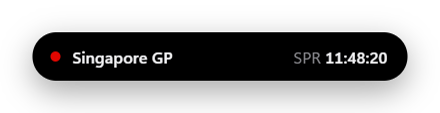
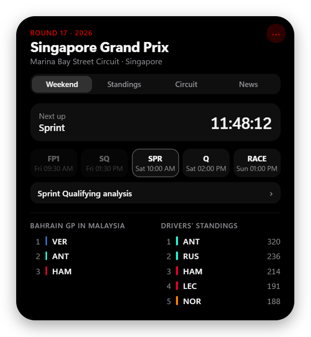
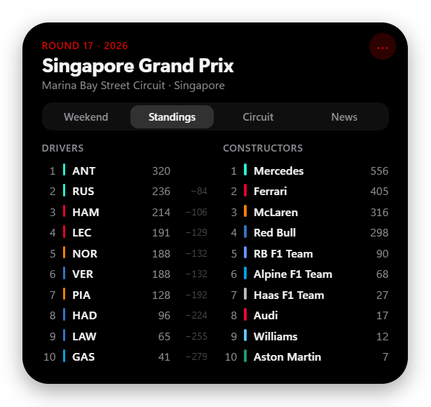
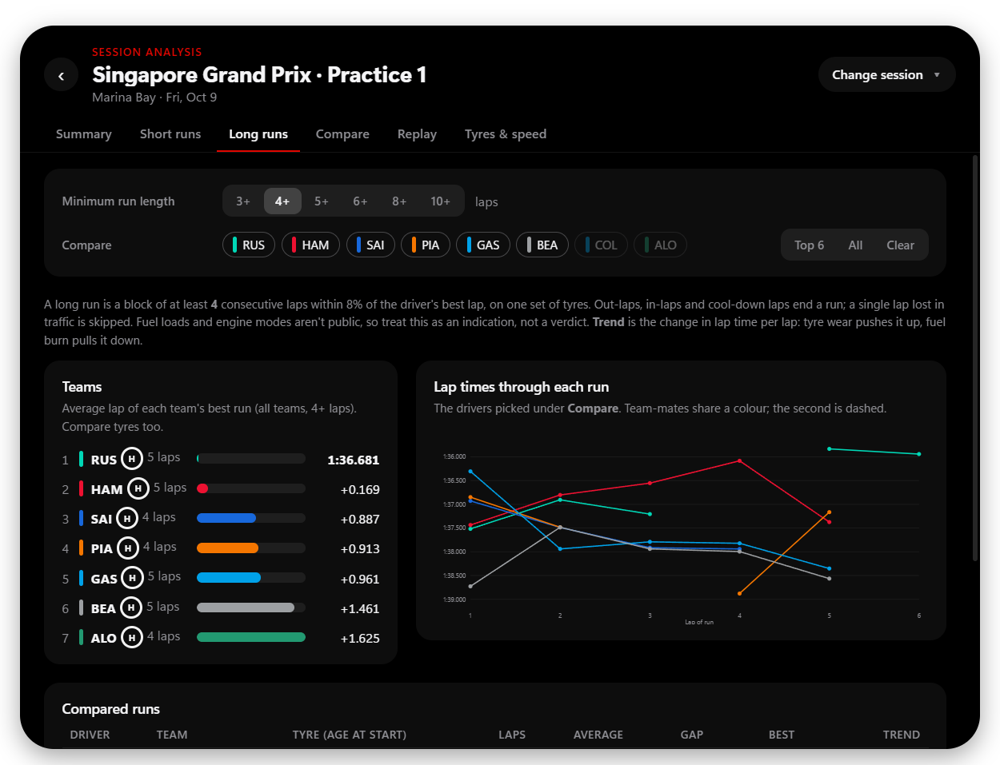

# F1 Island

**An iPhone-style Dynamic Island for Formula 1, on your Windows desktop.**

A small pill sits at the top of your screen with the countdown to the next session. Hover it and it expands with the weekend schedule, standings, circuit history and news. During a session it pops out with flag alerts (Safety Car, red flag, VSC, penalties…). After a session it expands a second time into a full analysis panel: long runs, driver telemetry comparison and a replay of every car on the track map.

> **Unofficial fan project.** Not affiliated with, endorsed by or connected to Formula 1, the FIA or any team. See [Disclaimer](#disclaimer).

<p align="center">
  <br>
  
</p>

---

## What to expect

- **Windows only** (built and tested on Windows 11). It's an Electron app, so macOS/Linux may mostly work, but always-on-top, click-through and the tray haven't been tried there.
- **Early version (0.1).** It works day to day, but expect rough edges. There's no installer yet: you run it from source with Node.js (two commands, below).
- **Free data, no accounts or API keys.** Everything comes from free public sources (see [Where the data comes from](#where-the-data-comes-from)). Those sources are run by other people and can change or go down; when they do, parts of the island show "unavailable" instead of data.
- **Live alerts are the newest part.** They use F1's public live-timing feed and have been tested with the built-in preview and recorded data. If an alert doesn't fire during a real session, please [open an issue](../../issues) saying what happened on track.
- **Analysis numbers are estimates.** Long-run pace can't account for fuel loads or engine modes (nobody outside the teams knows them), and car telemetry is sampled about 4 times a second, so traces are smoother than broadcast graphics.

## Features

### The island

<p align="center">
  
  
  
</p>

**Hover the pill** and it expands into four pages:

- **Weekend:** countdown, every session in your local time, last race podium, top 5 drivers.
- **Standings:** drivers' top 10 with the gap to the leader, and the constructors.
- **Circuit:** track map, last year's pole, winner and fastest lap, recent winners.
- **News:** latest headlines from Motorsport.com, The Race, Autosport and BBC Sport; click one for its summary.

It also:

- **Stays out of your way:** always on top, but it never takes keyboard focus and everything around the pill is click-through.
- **Drag it anywhere,** onto any monitor. Drop it near the top-centre of a screen to snap it back. Its position is remembered.
- **Auto-hide:** shrinks to a faint line and opens when you rest the mouse on it.
- **`Ctrl+Alt+F`** opens or closes it from anywhere.
- **Heads-up:** it peeks open 5 minutes before each session and when a session starts.

### Live flags & alerts

During a session the island pops out with a coloured alert:

| Event | Alert |
|---|---|
| Session starts / track clear | Green |
| Red flag | Red, pulsing |
| Safety Car, VSC, VSC ending | Amber, pulsing |
| Double yellow | Yellow, with the sector |
| Chequered flag | Chequered |
| Penalties, investigations, steward decisions, rain | Blue, with the message |

While a flag is out, the pill shows it (**SC / VSC / RED / YEL**) with a coloured ring, plus the lap and the leader. **Preview alerts** in the menu plays every alert, so you can see them any time.

### Session analysis (the island expands again)

Click **"… analysis ›"** and the island grows into a large panel for any completed session of the season. Drag it by its header; **‹** goes back.

<p align="center"></p>

- **Summary:** classification (with Q1/Q2/Q3 in qualifying), weather, key race control messages, deleted lap times.
- **Short runs:** best lap per driver with tyre and age, sector times, ideal lap, team ranking.
- **Long runs / Race pace:** detected race-simulation runs with team ranking, lap-by-lap chart and tyre degradation trend. You choose the minimum run length and which drivers to compare.
- **Compare:** any two drivers, any lap each: lap and sector times, a track map coloured by who was faster in each mini-sector, and telemetry traces (speed, time gap, throttle, brake, gear) with a hover crosshair.
- **Replay:** the whole session played back on the track map with every car, the running order and race control messages, at 1× to 32× speed with a timeline to scrub.
- **Tyres & speed:** laps per compound per team, speed-trap top speeds.

<p align="center">
  <br>
  
</p>

## Install and run

You need **Windows 10 or 11**, **[Node.js](https://nodejs.org) 20 or newer** and **git**.

```bash
git clone https://github.com/AymanBAHHOU/f1-island.git
cd f1-island
npm install
npm start
```

The island appears at the top-centre of your main screen, and a red dot appears in the system tray (it may be hidden behind the **^** arrow next to the clock).

To have it start with Windows, tick **Start with Windows** in the tray menu.

## Using it

| To… | Do this |
|---|---|
| See more | Hover the pill |
| Keep it open | Click the island, or tick **Keep open** in its menu |
| Open the settings menu | Right-click the island, click **⋯**, or right-click the tray icon |
| Move it | Drag the pill (or the big panel by its header) |
| Put it back at the top-centre | Menu → **Reset position** |
| Show / hide from the keyboard | `Ctrl+Alt+F` |
| Hide it until hovered | Menu → **Auto-hide until hovered** |
| See every alert type | Menu → **Preview alerts** |
| Quit | Tray icon → **Quit** |

Settings are saved in `%APPDATA%\f1-island\settings.json`. The hotkey can be changed there (`"hotkey": "CommandOrControl+Alt+F"`).

## Where the data comes from

All free and public; no account or key needed.

| What | Source |
|---|---|
| Schedule, results, standings, circuit history | [Jolpica F1 API](https://github.com/jolpica/jolpica-f1) (successor of the Ergast API) |
| Session analysis, telemetry, car positions, replay | [OpenF1](https://openf1.org) free historical data (available about 30 minutes after a session ends) |
| Live flags, race control, lap count, running order | F1's public live-timing feed (the topics that don't need an F1TV account). Connected only from 15 minutes before a session until an hour after it |
| News | RSS feeds from Motorsport.com, The Race, Autosport and BBC Sport. Articles open on the publisher's site |

The app caches responses and spaces out requests to respect these services' rate limits. Thank you to the people who run them.

## Known limitations

- No installer yet; run from source.
- Windows only (tested on Windows 11).
- Live alerts depend on F1's live-timing feed staying publicly accessible.
- Long-run pace is an estimate (unknown fuel loads and engine modes).
- Telemetry and positions are ~4 samples per second.
- Replay goes up to 32×; faster than that, position data can't download quickly enough.

## Development

```
main.js               Electron main process: window, tray, hotkey, dragging, IPC
preload.js            Bridge between the island page and the main process
src/data.js           Schedule, results, standings, circuit history (Jolpica)
src/analysis.js       Session analysis, telemetry, track maps, replay data (OpenF1)
src/livetiming.js     F1 live-timing client
src/alerts.js         Which live events become which alerts
src/news.js           RSS headlines
src/settings.js       Saved settings
renderer/             The island itself: pages, alerts, analysis view, track maps
docs/screenshots/     README images
```

Developer flags (after `npm start --`):

| Flag | Effect |
|---|---|
| `--pinned` | Start expanded |
| `--page=standings` | Open on a page (`weekend`, `standings`, `circuit`, `news`) |
| `--big --tab=compare` | Start in the analysis view on a tab (`summary`, `short`, `long`, `compare`, `replay`, `tyres`) |
| `--start=<ISO time>` | With `--big`: analyse the session starting at that time |
| `--demo-alerts` | Play every alert type after start-up |
| `--screenshot=<file.png>` | Save a PNG of the island and quit (with `--screenshot-delay=<ms>`) |

Issues and pull requests are welcome.

## Disclaimer

F1 Island is an unofficial fan project. It is not associated in any way with the Formula 1 companies, the FIA or any Formula 1 team. F1, FORMULA ONE, FORMULA 1, FIA FORMULA ONE WORLD CHAMPIONSHIP, GRAND PRIX and related marks are trademarks of Formula One Licensing B.V. Data belongs to its respective providers; news articles belong to their publishers.

## License

[MIT](LICENSE)
