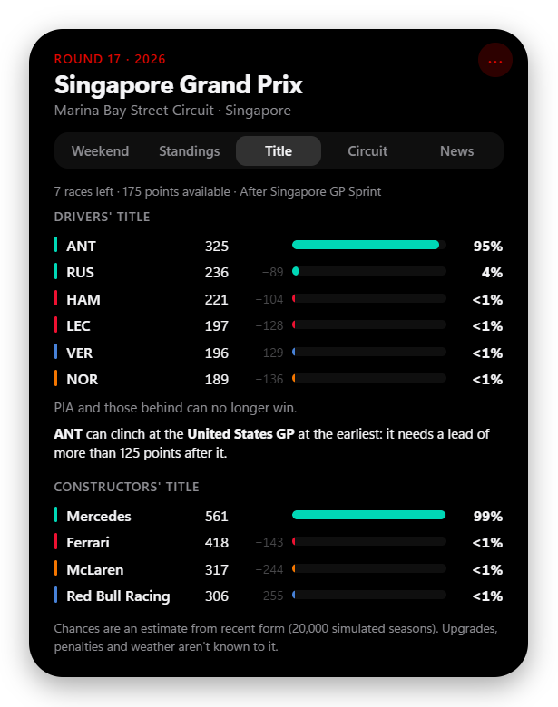

# F1 Island

[](https://github.com/AymanBAHHOU/f1-island/actions/workflows/ci.yml)

**An iPhone-style Dynamic Island for Formula 1, on your macOS or Windows desktop.**

A small pill sits at the top of your screen with the countdown to the next session. Hover it and it expands with the weekend schedule, standings, circuit history and news. During a session it pops out with flag alerts (Safety Car, red flag, VSC, penalties…). After a session it expands a second time into a full analysis panel: long runs, driver telemetry comparison and a replay of every car on the track map.

> **Unofficial fan project.** Not affiliated with, endorsed by or connected to Formula 1, the FIA or any team. See [Disclaimer](#disclaimer).

<p align="center">
  <br>
  
</p>

---

## What to expect

- **macOS and Windows.** macOS has a menu-bar app with no Dock icon, a floating panel across Spaces, Mac shortcuts and packaged-app login support. Windows keeps its existing tray behavior. Linux is not supported.
- **Early version (0.1).** Expect rough edges. Run from source, or build a macOS `.app`, DMG and ZIP with the commands below. These are local ad-hoc signed builds, not notarized public releases.
- **Free data, no accounts or API keys.** Everything comes from free public sources (see [Where the data comes from](#where-the-data-comes-from)). Those sources are run by other people and can change or go down; when they do, parts of the island show "unavailable" instead of data.
- **Live alerts are the newest part.** They use F1's public live-timing feed and have been tested with the built-in preview and recorded data. If an alert doesn't fire during a real session, please [open an issue](../../issues) saying what happened on track.
- **Analysis numbers are estimates.** Long-run pace can't account for fuel loads or engine modes (nobody outside the teams knows them), and car telemetry is sampled about 4 times a second, so traces are smoother than broadcast graphics.

## Features

### The island

<p align="center">
  
  
  
</p>

**Hover the pill** and it expands into five pages:

- **Weekend:** countdown, every session in your local time, last race podium, top 5 drivers.
- **Standings:** drivers' top 10 with the gap to the leader, and the constructors.
- **Title:** who can still win each championship, their chances, and the earliest race the leader can clinch it (see below).
- **Circuit:** track map, last year's pole, winner and fastest lap, recent winners.
- **News:** latest headlines from Motorsport.com, The Race, Autosport and BBC Sport; click one for its summary.

It also:

- **Stays out of your way:** always on top, but it never takes keyboard focus and everything around the pill is click-through.
- **Drag it anywhere,** onto any monitor. Drop it near the top-centre of a screen to snap it back. Its position is remembered.
- **Auto-hide:** shrinks to a faint line and opens when you rest the mouse on it.
- **Dock to top edge (Windows):** tick **Dock to top edge** in the menu to attach the island flush to the top of the screen, centred, with shoulders that flare into the edge like the Mac notch. Drag it away to detach it, and drop it anywhere along the top edge to dock it again: it slides back to the centre.
- **`Cmd+Option+F` on Mac / `Ctrl+Alt+F` on Windows** opens or closes it from anywhere.
- **Heads-up:** it peeks open 5 minutes before each session and when a session starts.

### Title fight

<p align="center"></p>

- **Who can still win:** exact maths from the points still available (25 per race, 8 per Sprint; 43 / 15 for constructors). Drivers who can no longer catch the leader are listed as out.
- **Clinch scenario:** the earliest race the leader can wrap it up, and the lead they'd need after it.
- **Chances:** an estimate, not a prediction. The rest of the season is simulated 20,000 times from each driver's recent form (newer results count more, retirements affect reliability only), with uncertainty in each driver's pace. Backtested on real title fights: after round 15 of 2021 (Hamilton +2) it gives 55% / 45%, and after round 17 of 2025 (Piastri +25) it gives Piastri 71%, Norris 22%, Verstappen 7%. Norris went on to win; the model gave him a real chance.
- It doesn't know about upgrades, penalties, weather or team orders.

### Live flags & alerts

During a session the island pops out with a coloured alert:

| Event | Alert |
|---|---|
| Session starts / track clear | Green |
| Red flag | Red, pulsing |
| Safety Car, VSC, VSC ending | Amber, pulsing |
| Double yellow | Yellow, with the sector |
| Chequered flag | Chequered |
| Penalties, investigations, steward decisions, rain | Blue, with the message |

**Live timing tower:** from 15 minutes before a session until 15 minutes after it finishes, the island opens on the **Live** tab, which is the first tab. After that it moves to the end of the tabs (still there for the rest of the hour, showing the final order) and the island opens on Weekend again. It shows the whole field in one table: interval and gap, last lap, the three sector times (purple fastest overall, green personal best, yellow slower), best lap (the fastest in the field in purple), tyre and its age, and PIT / EXIT / DNF / KO badges, with the race control feed beside it in its own scrolling column (on Windows the Live tab opens wider for this; on Mac the feed sits below the table). The Weekend tab keeps a top-10 preview. All from F1's public live-timing feed.

While a flag is out, the pill shows it (**SC / VSC / RED / YEL**) with a coloured ring, plus the lap and the leader. **Preview alerts** in the menu plays every alert, so you can see them any time.

### Session analysis (the island expands again)

Click **"… analysis ›"** and the island grows into a large panel for any completed session of the season. Drag it by its header; **‹** goes back.

<p align="center"></p>

- **Summary:** classification (with Q1/Q2/Q3 in qualifying), weather, key race control messages, deleted lap times.
- **Short runs:** best lap per driver with tyre and age, sector times, ideal lap, team ranking.
- **Long runs / Race pace:** detected race-simulation runs with team ranking, lap-by-lap chart and tyre degradation trend. You choose the minimum run length and which drivers to compare.
- **Compare:** any two drivers, any lap each: lap and sector times, a track map coloured by who was faster in each mini-sector, and telemetry traces (speed, time gap, throttle, brake, gear) with a hover crosshair.
- **Replay:** the whole session played back on the track map with every car, the running order and race control messages, at 1× to 32× speed with a timeline to scrub.
- **Tyres & speed:** laps per compound per team, speed-trap top speeds.

<p align="center">
  <br>
  
</p>

## Install and run

### Download

Get the latest build from [**Releases**](https://github.com/AymanBAHHOU/f1-island/releases/latest):

- **Windows 10/11:** `…-win-setup.exe` (installer) or `…-win-portable.exe` (no install).
- **macOS 12+:** `…-mac-arm64.dmg` (Apple Silicon) or `…-mac-x64.dmg` (Intel).

Builds aren't code-signed yet, so Windows SmartScreen or macOS Gatekeeper will ask you to confirm the first time (details on the release page).

#### Updates

- **Windows installer:** checks GitHub for a newer release shortly after it starts and every few hours, downloads it in the background, and shows **Restart to update** beside the menu button. It also installs when you next quit. **Check for updates** in the menu forces a check.
- **Windows portable app and the Mac app:** can't replace themselves (a portable exe has no installer; macOS only self-updates signed apps), so they show **vX.Y.Z available**, which opens the download page.
- Running from source doesn't check.

### From source


You need **macOS 12 or newer** (Apple Silicon or Intel), or **Windows 10 or 11**, plus **[Node.js](https://nodejs.org) 20 or newer** and **git**. Running from source on macOS also needs Apple's Command Line Tools (`xcode-select --install`) to build the tiny native notch-geometry helper.

```bash
git clone https://github.com/AymanBAHHOU/f1-island.git
cd f1-island
npm ci
npm start
```

### macOS

On a notched MacBook, the island **attaches to the camera notch at the very top of the screen**. Hover the notch itself to smoothly open the weekend panel beneath it. Move away to return to your chosen idle appearance. The physical camera area is always left empty: no content is placed behind it.

- Native public AppKit APIs (`safeAreaInsets`, `auxiliaryTopLeftArea`, `auxiliaryTopRightArea`) measure the actual notch in logical points, including scaled Retina modes. A small universal helper is built automatically and bundled with packaged apps; Node.js/Xcode are not needed to run a packaged app.
- A single anti-aliased vector surface blends smooth shoulders and corners into the screen edge. Frame-rate-independent interpolation moves every edge together without overshoot; auto-hide and initial reveal start inside the physical notch edges. Every notch state, including expanded red-flag views, has a black, borderless silhouette: flag colours stay in the content badges and banners, never across the top edge. The system **Reduce Motion** preference snaps directly to the final shape.
- **Drag away to detach; drop near the camera to attach.** Hover to open the panel, then drag its header away from the notch. The floating island snaps back automatically when dropped near the camera, including when dragging the analysis panel. There is no manual attachment toggle. Detached positions survive display refreshes and restarts; **Reset position** returns to the notch.
- **Idle appearance → Notch only:** stays tucked inside the physical notch until hovered (or explicitly opened with the hotkey/menu).
- **Idle appearance → Stretched:** a wider, slim, pure-black bar with F1 branding and a camera-safe ticker. No coloured outer border, top stroke or halo exposes the camera cutout; status colours stay inside the emblem and chips. Before a session it shows the GP, next session, local start time and countdown. During a session it shows lap progress, the leader, flag status and recent race-control events (rotated every six seconds). Hovering still opens the full panel. New live events do not unexpectedly open it.
- Both idle choices are saved (using the existing `autoHide` preference). Floating / Windows mode retains the original auto-hide checkbox.
- External monitors, non-notched Macs, and unavailable native geometry fall back to the original floating island below the menu bar. With an external primary monitor, the default home prefers an available notched display. Display changes and wake refresh the geometry.

- A **checkered flag** in the menu bar opens the app's controls. There is no Dock icon or Cmd-Tab entry.
- Hover the island to expand it; use **Show / hide** in the flag menu or **Cmd+Option+F** to toggle it.
- The panel is configured to follow you across Spaces and fullscreen apps without taking keyboard focus. Spaces, fullscreen transitions, Stage Manager and multi-monitor behavior can vary by macOS setup; please report any issues.
- **Start at Login** is available in the packaged `.app`, not when running the development Electron binary. Install it in `/Applications` before enabling this. macOS also lists it in **System Settings → General → Login Items**.
- Settings and data caches live in `~/Library/Application Support/F1 Island/`. The app does not request Screen Recording or Accessibility access.

#### Preview with dummy data

The menu **Preview stretched bar** offers **Next session**, **Race / overtakes**, **Safety Car**, **Red flag** and **Penalty** scenarios. Previews are clearly marked **DEMO**, temporarily show the stretched bar, and do not write synthetic data to API caches. Choose **Live data (stop preview)** to restore real data and your selected idle appearance. Selecting an idle appearance also ends the preview.

```bash
npm start -- --idle=stretched --demo=safety-car
```

`--idle=notch|stretched` saves the chosen idle preference. `--demo=next|race|safety-car|red-flag|penalty` starts an in-memory preview, not a real race feed.

#### Build a Mac app

On a Mac with Node.js and Apple's Command Line Tools (`xcode-select --install`):

```bash
npm ci
npm run pack:mac                  # .app, DMG and ZIP for this Mac's architecture
# Or explicitly build for either architecture:
npm run pack:mac -- --arm64       # Apple Silicon
npm run pack:mac -- --x64         # Intel
npm run pack:mac:dir              # just the .app, for development
```

Artifacts are written to `dist/`. Open the DMG and drag **F1 Island** to **Applications**, or copy `dist/mac-arm64/F1 Island.app` (Apple Silicon) / `dist/mac/F1 Island.app` (Intel). A packaged app does not need Node.js installed to run.

The default build uses **ad-hoc signing**, not an Apple Developer ID, and is **not notarized**. A downloaded copy may be blocked by Gatekeeper. Review the source/build provenance before approving it through **System Settings → Privacy & Security → Open Anyway**; do not disable Gatekeeper globally. No prebuilt notarized release is provided by these instructions.

For public distribution, maintainers must supply their own Developer ID certificate and notarization credentials. For example, with a certificate already in the keychain:

```bash
# Set APPLE_ID, APPLE_APP_SPECIFIC_PASSWORD and APPLE_TEAM_ID in your environment.
npm run pack:mac -- --config.mac.identity="Developer ID Application: Your Name (TEAMID)" --config.mac.notarize=true
```

Never commit credentials. The generated app icon uses an original checkered flag, not official F1 artwork.

### Windows

The island appears at the top-centre of your main screen, and a red dot appears in the system tray (it may be hidden behind the **^** arrow next to the clock). To have it start with Windows, tick **Start with Windows** in the tray menu.

#### Build a Windows app

```bash
npm ci
npm run pack:win       # installer + portable .exe
npm run pack:win:dir   # just the unpacked app, for development
```

Artifacts are written to `dist/`:

- **`F1-Island-<version>-win-setup.exe`**: installer. Installs for the current user (no admin needed), lets you choose the folder, adds Start-menu and desktop shortcuts, and can be removed from **Settings → Apps**. It updates itself (see below).
- **`F1-Island-<version>-win-portable.exe`**: runs without installing.

Neither needs Node.js. Every pull request also builds both in CI (the **Windows app build** artifact).

The builds are **not code-signed**, so Windows SmartScreen shows **"Windows protected your PC"** the first time: choose **More info → Run anyway** if you trust where the file came from. Signing needs a code-signing certificate; electron-builder picks one up from `CSC_LINK` / `CSC_KEY_PASSWORD`. Never commit certificates or passwords.

Settings are shared with the development version (`%APPDATA%\f1-island\`).

## Using it

| To… | Do this |
|---|---|
| See more | Hover the pill |
| Keep it open | Click the island, or tick **Keep open** in its menu |
| Open the settings menu | Right-click the island, click **⋯**, or open the menu-bar / tray icon |
| Move it | Drag the pill (or the big panel by its header) |
| Put it back at the top-centre | Menu → **Reset position** |
| Show / hide from the keyboard | Mac: `Cmd+Option+F`; Windows: `Ctrl+Alt+F` |
| Choose idle behavior | Notch: **Idle appearance → Notch only / Stretched**; floating / Windows: **Auto-hide until hovered** |
| See every alert type | Menu → **Preview alerts** |
| Quit | Menu-bar / tray icon → **Quit F1 Island** / **Quit** |

Settings are saved in `~/Library/Application Support/F1 Island/settings.json` on Mac and `%APPDATA%\f1-island\settings.json` on Windows. The hotkey can be changed there (`"hotkey": "CommandOrControl+Alt+F"`); restart the app afterwards.

## Where the data comes from

All free and public; no account or key needed.

| What | Source |
|---|---|
| Schedule, results, standings, circuit history | [Jolpica F1 API](https://github.com/jolpica/jolpica-f1) (successor of the Ergast API) |
| Session analysis, telemetry, car positions, replay | [OpenF1](https://openf1.org) free historical data (available about 30 minutes after a session ends) |
| Live flags, race control, lap count, running order | F1's public live-timing feed (the topics that don't need an F1TV account). Connected only from 15 minutes before a session until an hour after it |
| News | RSS feeds from Motorsport.com, The Race, Autosport and BBC Sport. Articles open on the publisher's site |

The app caches responses and spaces out requests to respect these services' rate limits. Thank you to the people who run them.

## Known limitations

- Mac builds are ad-hoc signed, not notarized; public distribution needs an Apple Developer ID. Windows still runs from source.
- Notch geometry, hover/leave animations, camera-safe content placement, analysis expansion and auto-hide are smoke-tested on a notched Apple Silicon Mac. Fullscreen transitions, Stage Manager and multi-monitor setups still need broader interactive testing. Intel is a build target; native runtime testing is on Apple Silicon.
- The existing Electron 38 dependency is unchanged in this port. `npm audit` reports known runtime/build-tool advisories; upgrading Electron and auditing transitive packaging dependencies is recommended before public distribution.
- Live alerts depend on F1's live-timing feed staying publicly accessible.
- While any session is live, OpenF1 blocks free access (even to past sessions) until it ends. During a session the analysis view only shows sessions you've opened before (they're cached on disk); everything else returns afterwards.
- Long-run pace is an estimate (unknown fuel loads and engine modes).
- Telemetry and positions are ~4 samples per second.
- Replay goes up to 32×; faster than that, position data can't download quickly enough.

## Development

```
main.js               Electron main process: window, tray, hotkey, dragging, IPC
preload.js            Bridge between the island page and the main process
src/data.js           Schedule, results, standings, circuit history (Jolpica)
src/championship.js   Title fight: contention, clinch maths, form, simulation
src/analysis.js       Session analysis, telemetry, track maps, replay data (OpenF1)
src/livetiming.js     F1 live-timing client
src/alerts.js         Which live events become which alerts
src/news.js           RSS headlines
src/settings.js       Saved settings
src/platform.js       macOS / Windows window, shortcut and login-item behavior
src/notch.js          Native notch detection, screen-coordinate mapping, hover geometry
src/demo.js           Labelled dummy next-session / race scenarios for preview and tests
native/notch-info.m   Public AppKit notch-geometry helper (universal macOS binary)
renderer/             The island itself: pages, alerts, analysis view, track maps
renderer/notch-idle.js Pure stretched-bar presenter (countdowns, flags, race events)
docs/screenshots/     README images
test/                 Unit tests (node --test)
scripts/              Syntax check, macOS smoke test, generated app icon
build/                macOS signing entitlements and generated icon
electron-builder.yml  macOS .app / DMG / ZIP packaging
.github/workflows/    CI
```

Developer flags (after `npm start --`):

| Flag | Effect |
|---|---|
| `--pinned` | Start expanded |
| `--page=standings` | Open on a page (`weekend`, `standings`, `circuit`, `news`) |
| `--big --tab=compare` | Start in the analysis view on a tab (`summary`, `short`, `long`, `compare`, `replay`, `tyres`) |
| `--start=<ISO time>` | With `--big`: analyse the session starting at that time |
| `--demo-alerts` | Play every alert type after start-up |
| `--demo=safety-car` | Labelled dummy stretched-bar preview (`next`, `race`, `safety-car`, `red-flag`, `penalty`) |
| `--idle=stretched` | Save the Mac idle appearance (`notch` or `stretched`) |
| `--screenshot=<file.png>` | Save a PNG of the island and quit (with `--screenshot-delay=<ms>`) |

### Releasing

1. Bump `version` in `package.json` in a pull request and merge it.
2. Tag the merge and push the tag:
   ```bash
   git tag v0.2.0
   git push origin v0.2.0
   ```
3. The **Release** workflow checks the tag matches `package.json`, runs the tests, builds the Windows installer and portable app and the macOS DMG/ZIP (Apple Silicon and Intel), and creates a **draft** release with them attached (including `latest.yml`, which the installer's auto-update reads) and generated notes.
4. Review the draft on GitHub and **Publish** that draft (don't create a new release: the files are attached to the draft). Publishing from the web page can leave the release on a placeholder `untagged-…` tag; the **Fix release tag** workflow notices that and points it back at `vX.Y.Z` within a minute (the installer's auto-update needs the real tag). Installed copies pick the update up once it's published.

### Checks

```bash
npm run check   # syntax-check every JavaScript file
npm test        # unit tests (alert rules, live timing, session analysis, championship maths)
npm run test:mac # macOS integration smoke test (requires a graphical login session)
# Optional PNG captures of the compact, expanded and analysis notch states:
npm run test:mac -- --screenshots=/path/to/captures
```

Syntax checks and unit tests run on Linux, Windows and macOS on every pull request (GitHub Actions). A separate macOS job builds and archives the app, including the universal native helper. The graphical smoke test uses dummy schedule/race fixtures instead of live data services. It checks the real window's panel properties, workspace visibility, hidden Dock icon, placement, preload and rendering; on notched hardware it also tests both idle modes, all five dummy scenarios, camera-safe content, interpolated motion, analysis, reduced motion, drag-to-detach and magnetic reattachment (including persistence across a display refresh). Its cursor reads are simulated: it never moves the real mouse, switches Spaces or registers login items.

Issues and pull requests are welcome.

## Disclaimer

F1 Island is an unofficial fan project. It is not associated in any way with the Formula 1 companies, the FIA or any Formula 1 team. F1, FORMULA ONE, FORMULA 1, FIA FORMULA ONE WORLD CHAMPIONSHIP, GRAND PRIX and related marks are trademarks of Formula One Licensing B.V. Data belongs to its respective providers; news articles belong to their publishers.

## License

[MIT](LICENSE)
